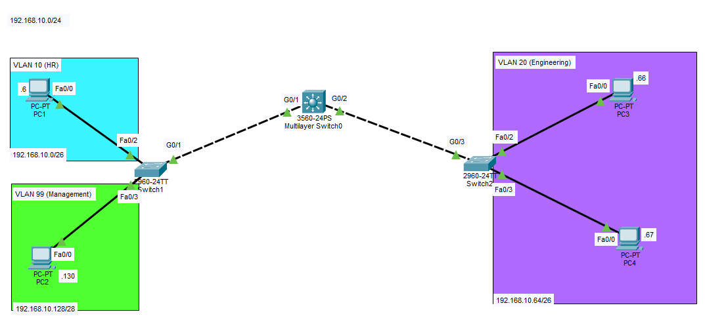
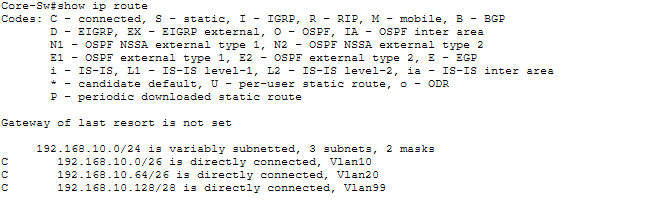
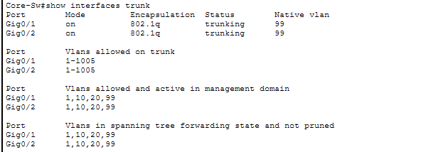
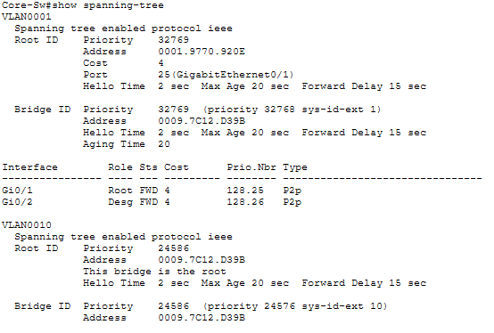
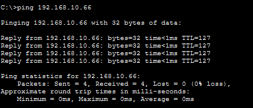

# Lab 01: Enterprise Core & Layer 2 Fundamentals

## Executive Summary
This lab builds a complete Layer 2/3 enterprise campus network core. It demonstrates secure device initialization, static VLSM subnetting, VLAN segmentation, 802.1Q trunking, SVI Inter-VLAN routing, and STP Root Bridge tuning.

---

## 1. Network Topology


---

## 2. Addressing & Subnetting Table
*Base Network:* `192.168.10.0/24`

| VLAN ID | Subnet Name | Subnet Network | Subnet Mask | Usable Range | Core-SW SVI Gateway |
| :---: | :--- | :--- | :--- | :--- | :--- |
| **10** | HR | `192.168.10.0/26` | `255.255.255.192` | `.1` – `.62` | `192.168.10.1` |
| **20** | Engineering | `192.168.10.64/26` | `255.255.255.192` | `.65` – `.126` | `192.168.10.65` |
| **99** | Management | `192.168.10.128/28` | `255.255.255.240` | `.129` – `.142` | `192.168.10.129` |

---

## 3. Step-by-Step CLI Configuration

### A. Core Switch (`Core-SW`)
```text
enable
configure terminal
hostname Core-SW
ip routing

vlan 10
 name HR
vlan 20
 name Engineering
vlan 99
 name Management
exit

interface range GigabitEthernet 0/1 - 2
 switchport trunk encapsulation dot1q
 switchport mode trunk
 switchport trunk native vlan 99
 no shutdown
exit

interface Vlan 10
 ip address 192.168.10.1 255.255.255.192
 no shutdown
exit

interface Vlan 20
 ip address 192.168.10.65 255.255.255.192
 no shutdown
exit

interface Vlan 99
 ip address 192.168.10.129 255.255.255.240
 no shutdown
exit

spanning-tree vlan 10,20,99 root primary
end
write memory
```

### B. Access Switches (`Access-SW1` & `Access-SW2`)
```text
enable
configure terminal
hostname Access-SW1

vlan 10
 name HR
vlan 20
 name Engineering
vlan 99
 name Management
exit

interface FastEthernet 0/2
 switchport mode access
 switchport access vlan 10
 no shutdown
exit

interface FastEthernet 0/3
 switchport mode access
 switchport access vlan 99
 no shutdown
exit

interface GigabitEthernet 0/1
 switchport mode trunk
 switchport trunk native vlan 99
 no shutdown
exit
end
write memory
```

---

## 4. Verification & Operational Proof

### Routing Table Verification (`show ip route`)
```text
Core-SW# show ip route
C    192.168.10.0/26 is directly connected, Vlan10
C    192.168.10.64/26 is directly connected, Vlan20
C    192.168.10.128/28 is directly connected, Vlan99
```


### Trunking Status (`show interfaces trunk`)


### Spanning Tree Root Bridge (`show spanning-tree`)


### End-to-End Inter-VLAN Ping Test


---

## 5. Security & Architectural Insights
- **VLAN Isolation:** Isolates departmental traffic to limit internal broadcast domains and attack vectors.
- **STP Determinism:** Explicitly enforcing the Root Bridge prevents rogue switch insertion attacks from hijacking network traffic paths.
- **Native VLAN Hardening:** Moving away from default VLAN 1 mitigates double-tagging VLAN hopping vulnerabilities.
