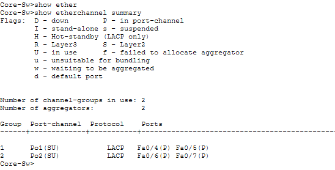
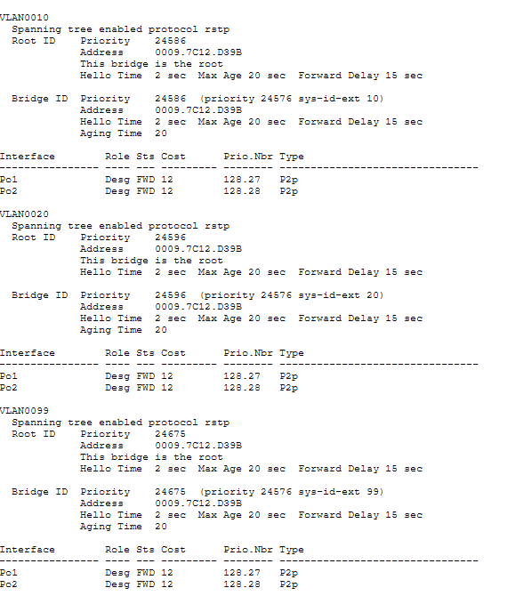

# Lab 02: Layer 2 Resiliency, Hardening, and EtherChannel

## Executive Summary
This lab upgrades the enterprise Layer 2 campus network for high availability and edge security. It demonstrates migration to Rapid Spanning Tree Protocol (RSTP / 802.1w), link aggregation using LACP EtherChannel (`Po1` & `Po2`), and access-layer hardening via PortFast, BPDU Guard, and sticky Port Security.

---

## 1. Network Topology


---

## 2. Link Aggregation & Hardening Matrix

| Switch | Interface(s) | Channel-Group / Role | Protocol / Feature | Mode / Assignment |
| :--- | :--- | :--- | :--- | :--- |
| **Core-SW** | `Fa0/4` – `Fa0/5` | `Port-Channel 1` (Uplink to Access-SW1) | LACP (`802.3ad`) / 802.1Q Trunk | `active` / Native VLAN 99 |
| **Core-SW** | `Fa0/6` – `Fa0/7` | `Port-Channel 2` (Uplink to Access-SW2) | LACP (`802.3ad`) / 802.1Q Trunk | `active` / Native VLAN 99 |
| **Access-SW1** | `Fa0/4` – `Fa0/5` | `Port-Channel 1` (Uplink to Core-SW) | LACP (`802.3ad`) / 802.1Q Trunk | `active` / Native VLAN 99 |
| **Access-SW2** | `Fa0/4` – `Fa0/5` | `Port-Channel 2` (Uplink to Core-SW) | LACP (`802.3ad`) / 802.1Q Trunk | `active` / Native VLAN 99 |
| **Access-SW1 / 2** | `Fa0/2` – `Fa0/3` | User Edge Access Ports | PortFast, BPDU Guard, Port Security | Max 2 MACs / Sticky / Restrict |

---

## 3. Step-by-Step CLI Configuration

### A. Core Switch (`Core-SW`)
```text
enable
configure terminal
hostname Core-SW

! Migrate to Rapid Spanning Tree Protocol (RSTP)
spanning-tree mode rapid-pvst
spanning-tree vlan 10,20,99 root primary

! Disable legacy single Gigabit uplinks
interface range GigabitEthernet 0/1 - 2
 shutdown
 no switchport mode trunk
exit

! Configure EtherChannel Bundle 1 (facing Access-SW1)
interface range FastEthernet 0/4 - 5
 channel-group 1 mode active
 no shutdown
exit

interface Port-Channel 1
 switchport trunk encapsulation dot1q
 switchport mode trunk
 switchport trunk native vlan 99
exit

! Configure EtherChannel Bundle 2 (facing Access-SW2)
interface range FastEthernet 0/6 - 7
 channel-group 2 mode active
 no shutdown
exit

interface Port-Channel 2
 switchport trunk encapsulation dot1q
 switchport mode trunk
 switchport trunk native vlan 99
exit

end
write memory
```

### B. Access Switches (`Access-SW1` & `Access-SW2`)
*(Note: Configure `channel-group 1` / `Port-Channel 1` on `Access-SW1`, and `channel-group 2` / `Port-Channel 2` on `Access-SW2`)*
```text
enable
configure terminal
hostname Access-SW1

! Migrate to Rapid Spanning Tree Protocol (RSTP)
spanning-tree mode rapid-pvst

! Disable legacy single Gigabit uplink
interface GigabitEthernet 0/1
 shutdown
 no switchport mode trunk
exit

! Configure EtherChannel Uplink Bundle
interface range FastEthernet 0/4 - 5
 channel-group 1 mode active
 no shutdown
exit

interface Port-Channel 1
 switchport mode trunk
 switchport trunk native vlan 99
exit

! Edge Port Hardening (PortFast, BPDU Guard & Port Security)
interface range FastEthernet 0/2 - 3
 switchport mode access
 spanning-tree portfast
 spanning-tree bpduguard enable
 switchport port-security
 switchport port-security maximum 2
 switchport port-security violation restrict
 switchport port-security mac-address sticky
 no shutdown
exit

end
write memory
```

---

## 4. Verification & Operational Proof

### EtherChannel Bundle Status (`show etherchannel summary`)
```text
Core-SW# show etherchannel summary
Number of channel-groups in use: 2
Number of aggregators:           2

Group  Port-channel  Protocol    Ports
------+-------------+-----------+-----------------------------------------------
1      Po1(SU)         LACP      Fa0/4(P)    Fa0/5(P)
2      Po2(SU)         LACP      Fa0/6(P)    Fa0/7(P)
```


### RSTP Root Bridge & Port-Channel States (`show spanning-tree`)
```text
VLAN0010
  Spanning tree enabled protocol rstp
  Root ID    Priority    24586
             Address     0009.7C12.D39B
             This bridge is the root

Interface           Role Sts Cost      Prio.Nbr Type
------------------- ---- --- --------- -------- --------------------------------
Po1                 Desg FWD 12        128.27   P2p
Po2                 Desg FWD 12        128.28   P2p
```


---

## 5. Security & Architectural Insights
* **Bandwidth & Link Redundancy (LACP):** Bundling physical links into `Po1` and `Po2` prevents STP from blocking redundant uplinks, doubling throughput while providing sub-second failover if a physical cable fails.
* **Rogue Switch Prevention (BPDU Guard):** Combining PortFast with BPDU Guard ensures user ports transition immediately to forwarding while automatically placing the port into `err-disabled` if an unauthorized switch sends BPDUs.
* **Layer 2 Access Control (Port Security):** Enforcing sticky MAC address limits prevents CAM table overflow (MAC flooding) attacks and blocks unauthorized hardware from connecting to open wall jacks.